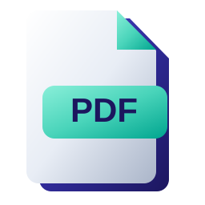
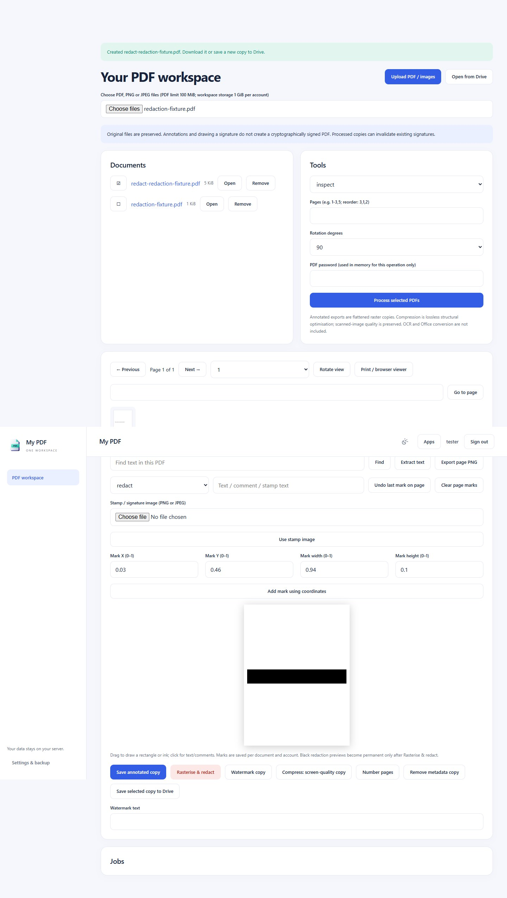

<p align="center"></p>

# My PDF

View, annotate and process PDF copies on your own server. An original Apache-2.0 One Workspace application; not an upstream fork.



## Windows download

Download the Windows x64 ZIP from [Releases](https://github.com/oneworkspacestudio/my-pdf/releases). Verify SHA256SUMS.txt, extract to a program folder and run **MyPDF.exe**. No Docker, WSL, Node.js or Python is needed at runtime. A modern browser and a dedicated **NTFS** data folder are required. This is a **0.1.0-preview.1** release; unsigned Windows executables may prompt for trust.

The simplest managed installation is [One Workspace](https://github.com/oneworkspacestudio/one-workspace). New default apps are installed during manager updates unless explicitly excluded. Existing app data and user files are preserved.

## Included

PDF.js viewer with thumbnails, zoom, find, text extraction and page PNG; native merge, split ZIP, extract/reorder, remove/blank pages, rotation, lossless optimisation and metadata inspection/removal; images to PDF, watermark and page numbers; text, shapes, highlights, ink, comments and signature images; permanent raster redaction; approved Drive import and save-copy.

## Standalone

```powershell
.\MyPDF.exe --data C:\WorkspaceData\my-pdf --listen 127.0.0.1:8795
```

The app opens a one-time first-owner setup link. Choose your own password. Later starts reuse the same data folder. Keep private data separate from the executable and user-created files. Use a distinct port for each app. App Settings offers encrypted backup and account details; managed installations use MyAccounts automatically.

## Important limits

Redaction and annotated exports are raster copies: original text, forms, links, accessibility and cryptographic signatures are lost in that copy. Drawing a signature does not digitally sign a PDF. OCR, Office conversion and professional layout editing are not included. Native compression is lossless; the separate screen preset trades quality and searchable text for size. Browser raster exports: 50 pages/120 million pixels. PDF uploads: 100 MiB, 500 documents, 1 GiB per user. Native jobs: 1,000 total pages, 10 inputs, 512 MiB working memory, 60 seconds CPU, 90 seconds wall time. Limits can reject otherwise valid files.

See [operations and recovery](docs/OPERATIONS.md), [API contracts](docs/API.md), [acceptance evidence](docs/ACCEPTANCE.md), [architecture](docs/ARCHITECTURE.md) and [security](SECURITY.md). Preview status does not imply clean-machine, reboot, Windows-service or independent penetration-test certification.

## Build locally

Install Go 1.27.2 and Node.js 24+ for development only. Run `scripts/build.ps1 -Go <go.exe> -Npm <npm.cmd> -Release` from a clean committed checkout. The script uses pinned Go/npm dependencies, regenerates `.aui` UI, runs TypeScript, Go tests/vet and frontend contracts, builds the Windows icon/EXE, inventories dependency licenses and emits an immutable ZIP plus checksums. Browser tests: set APP_E2E_URL, APP_E2E_PASSWORD and run `npm run test:e2e` in web against disposable data.

No GitHub Actions are used. Distribution includes LICENSE, NOTICE, full dependency license texts, dependency inventory, compatibility and source build information. Source edits belong in `web/src/screens/*.aui`; generated React is reviewed and committed.
